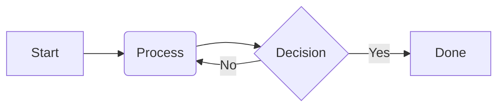
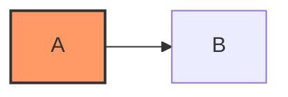

# 撰寫 Markdown

> 了解 Dart 與 Flutter 文件網站所支援的 Markdown 語法，以及相關的使用指引。


:::warning
本文件仍在撰寫中。
:::

我們的網站支援使用 [Markdown][] 撰寫內容，
同時也包含部分 [GitHub Flavored Markdown][] 的擴充語法，
以及其他自訂語法。

本頁將說明我們支援的 Markdown 語法，
以及撰寫 Markdown 的風格指引。

[Markdown]: https://commonmark.org/
[GitHub Flavored Markdown]: https://github.github.com/gfm/

## 一般指引

請優先使用 Markdown 語法，而非自訂 HTML 或元件（components）。
原生 Markdown 較容易維護、工具較容易解析，
且未來如需遷移也較為方便。

## 程式碼區塊

請勿使用 Markdown 的縮排式程式碼區塊，
僅使用反引號標記的圍欄式（fenced）程式碼區塊，
並且務必指定語言。例如：

````markdown
```dart
void main() {
  print('Hello world!');
}
```
````

若想進一步了解如何自訂程式碼區塊，請參閱專門的 [程式碼區塊][Code blocks] 文件。

[Code blocks]: /contribute/docs/code-blocks


## Mermaid diagrams

若要在 Markdown 檔案中繪製流程圖、循序圖及其他圖表，
請使用以 `mermaid` 作為語言識別字的 fenced code block：

````markdown

````

### Style Mermaid diagrams

Mermaid 圖表會在伺服器端渲染為 SVG，每種主題各渲染一次。
兩種版本都會包含在頁面中，並由 CSS 顯示與網站目前淺色或深色主題相符的那一個。
圖表會沿用預設的 `Google Sans Flex` 字型。

#### In-diagram styling (Recommended)

當你需要為特定節點設定自訂顏色時，
請直接在圖表中使用 Mermaid 內建的
[`classDef` 與 `:::styleName` 語法][`classDef` and `:::styleName` syntax]定義：



#### SCSS styling

若要調整整個網站的圖表整體版面配置、邊框或背景，
請編輯 [`_mermaid.scss`][]：

```scss
.mermaid-container {
  // Container styling (padding, margins, background, border)

  // Fallback shown only if server rendering the diagram failed
  pre.mermaid {
    // Fallback styles
  }
  
  .mermaid-theme {}

  .mermaid-theme-light {}

  .mermaid-theme-dark {}

  svg {
    // Custom SVG element overrides (requires !important)
  }
}
```

[`classDef` and `:::styleName` syntax]: https://mermaid.js.org/syntax/flowchart.html#styling-and-classes
[`_mermaid.scss`]: https://github.com/flutter/website/blob/main/packages/site_shared/lib/_sass/components/_mermaid.scss

